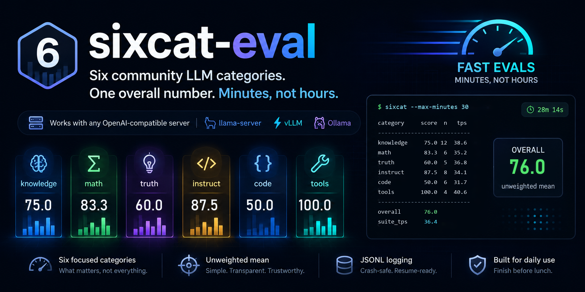

# sixcat-eval

**120 challenging questions. Six categories. One first-response score. A 30-minute budget.**

[What it is](#what-it-is) · [How it works](#how-it-works) · [Historical results](#historical-results) · [Quick start](#quick-start) · [Usage and options](#usage-and-options) · [Documentation](#documentation) · [Contributing](#contributing) · [Attribution and license](#attribution-and-license) · [Release notes](RELEASE_NOTES.md)

## What it is

SixCat is a daily regression check for local models, quantizations and provider-served models, not another benchmark that takes all afternoon.

**Current release: [v0.8.3 — All 120 items with local Code execution](https://github.com/vcruz305/sixcat-eval/releases/tag/v0.8.3).** Evaluate the model behind Hermes using its existing authentication, or let one Hermes model operate a deterministic run against another.

## How it works

Standard mode keeps the frozen `challenge-v1` selection: 20 items in each category, with the hardest-first ordering retained within each category. Categories dispatch round-robin through one bounded concurrent pool so a time-limited run does not finish Knowledge and Math while never reaching Tools.

## Historical results

[The original 0.5.1 README](README-v0.5.1.md), including its model results and self-evaluation caveats, is preserved unchanged. Do not compare those scores directly with parser-v5 results. [Release notes](RELEASE_NOTES.md) describe the migration.

Public scores posted by [Victor (@ViC305)](https://x.com/ViC305) are transcribed in [Posted results](docs/posted-results.md). The v0.5.1 receipts stay on that archived page. The posted GLM-5.3 88.3 slice is a different run from the archived 91.7 receipt, and the posted Qwen3.8-27B board rows are different setups from the archived EXL3 4.00bpw 75.0 receipt.

Sorted by overall, highest first. Every figure is copied from [Posted results](docs/posted-results.md).

| date (PT) | model | precision | hardware / serving | weights (HF) | sixcat | n | overall | decode tok/s | post |
|---|---|---|---|---|---|---|---:|---|---|
| 2026-10-17 | Qwen3.8-Flash-Next (FP4-Local, TP1) ⓐ | FP4-Local | 1x DGX Spark · b12x vLLM + MTP4 | [nvidia/Qwen3.8-Flash-Next-FP4-Local](https://huggingface.co/nvidia/Qwen3.8-Flash-Next-FP4-Local) · upstream, linked in article | — (vendor policy, thinking on) | 120 (109/120) | 90.8 | 68 | [post](https://x.com/ViC305/status/2111523015234384166) |
| 2026-08-22 | Ox Alpha (via Nous Portal) † | cloud | hosted · Nous Portal API | — | — | 60-item slice (54/60) | 90.0 (partial) † | n/p | [post](https://x.com/ViC305/status/2091361652776292473) |
| 2026-10-17 | Qwen3.8-Flash-Next NVFP4 (NVIDIA) | NVFP4 | 1x DGX Spark · b12x vLLM, base decode | [nvidia/Qwen3.8-Flash-Next-NVFP4](https://huggingface.co/nvidia/Qwen3.8-Flash-Next-NVFP4) · upstream, linked in article | — (vendor policy, thinking on) | 119 | 89.9 | 18.70 | [post](https://x.com/ViC305/status/2111523015234384166) |
| 2026-10-17 | Qwen3.8-Flash-Next FP4-Local TP2 † | FP4-Local | 2x DGX Spark · distributed b12x vLLM | [nvidia/Qwen3.8-Flash-Next-FP4-Local](https://huggingface.co/nvidia/Qwen3.8-Flash-Next-FP4-Local) · upstream, linked in article | — (vendor policy, thinking on) | 118/120 eligible | 89.72 (partial) † | 46.35 | [post](https://x.com/ViC305/status/2111523015234384166) |
| 2026-09-09 | Qwen3.8-Flash-Next (GGUF Q4_K_M, BF16 PLE on NVMe, MTP on) ‖ | GGUF Q4_K_M (BF16 PLE on NVMe, MTP on) | 1x DGX Spark · llama.cpp | [vcruz305/Qwen3.8-Flash-Next-GGUF](https://huggingface.co/vcruz305/Qwen3.8-Flash-Next-GGUF) · own, matched by name | v0.5.1 (vendor, thinking on) | 120 | 89.2 | 32.9 (p50) | [post](https://x.com/ViC305/status/2097723351993385463) |
| 2026-08-22 | GLM-5.3 (via ZenMux) † ‡ | cloud | hosted · ZenMux API | [zai-org/GLM-5.3](https://huggingface.co/zai-org/GLM-5.3) · upstream, variant not stated | — | 60-item slice (53/60) | 88.3 (partial) † ‡ | n/p | [post](https://x.com/ViC305/status/2091361652776292473) |
| 2026-09-09 | Qwen3.8-Flash-Next (EXL3 3.05bpw) ‖ ◊ | EXL3 3.05bpw (turboderp 3.05bpw_h5_ng5 per his recipe) | 1x DGX Spark · vLLM + vllm-exl3 | [turboderp/Qwen3.8-Flash-Next-exl3@3.05bpw_h5_ng5](https://huggingface.co/turboderp/Qwen3.8-Flash-Next-exl3/tree/3.05bpw_h5_ng5) · upstream, least certain ◊ | v0.5.1 (vendor, thinking on) | 120 | 86.7 | 47.6 (p50) | [post](https://x.com/ViC305/status/2097723351993385463) |
| 2026-10-26 | Nanbeige4.3-33B (dense, Llama-arch) ⓓ | SAGE-EXL3 4.50bpw (4.499880554 decoder-body bpw, 8-bit embeddings/head), 18.35 GiB | 1x NVIDIA RTX 4090 (24 GB) · ExLlamaV3 + TabbyAPI, 36,864 ctx, Q4 KV, batch 1 | [vcruz305/Nanbeige4.3-33B-SAGE-EXL3-4.50bpw](https://huggingface.co/vcruz305/Nanbeige4.3-33B-SAGE-EXL3-4.50bpw) · own | v0.8.3 (strict, thinking ON) | 120 (104/120) | 86.67 | 33.82 (token-weighted, 107 requests) | [post](https://x.com/ViC305/status/2114763560345805041) |
| 2026-10-17 | Qwen3.8-Flash-Next EXL3 4.05bpw (turboderp) | EXL3 4.05bpw | 1x DGX Spark · ExLlamaV3 + TabbyAPI | [turboderp/Qwen3.8-Flash-Next-exl3@4.05bpw_h6_ng6](https://huggingface.co/turboderp/Qwen3.8-Flash-Next-exl3/tree/4.05bpw_h6_ng6) · upstream, linked in article | — (vendor policy, thinking on) | 119 | 86.5 | 31.97 | [post](https://x.com/ViC305/status/2111523015234384166) |
| 2026-08-19 | Ornith-1.5-35B-A3B ⓑ | NVFP4 (ModelOpt) | 1x DGX Spark · vLLM, single node TP1 | [ornith-ai/Ornith-1.5-35B-A3B-NVFP4](https://huggingface.co/ornith-ai/Ornith-1.5-35B-A3B-NVFP4) · upstream, named in post | pre-0.5 | — | 85.0 | ~78 (prefill ~3891) | [post](https://x.com/ViC305/status/2090094880882393484) |
| 2026-10-16 | Nemotron 3.5 Super VL 120B-A12B | NVFP4 (NVIDIA) | 1x DGX Spark · vLLM 0.31.0 + FlashInfer, MTP-5 | [nvidia/NVIDIA-Nemotron-3.5-Super-VL-120B-A12B-NVFP4](https://huggingface.co/nvidia/NVIDIA-Nemotron-3.5-Super-VL-120B-A12B-NVFP4) · upstream, linked in post | — | 120 (101/120) | 84.17 | 37.3 | [post](https://x.com/ViC305/status/2111165770159845500) |
| 2026-08-25 | Apodex-1.1-mini | NVFP4 experts, FP8 attn/KV | 1x DGX Spark GB10 · SGLang (flashinfer_cutlass) | [apodex/Apodex-1.1-mini-NVFP4](https://huggingface.co/apodex/Apodex-1.1-mini-NVFP4) · upstream, linked in post | v0.4.4 (high-budget rerun) | 120 | 83.3 | 83 | [post](https://x.com/ViC305/status/2092349512044212705) |
| 2026-08-19 | Qwen3.8-27B stock Q4 § | Q4 | — | [Qwen/Qwen3.8-27B](https://huggingface.co/Qwen/Qwen3.8-27B) · upstream base, Q4 file not identified | pre-0.5 | — | 82.3 § | n/p | [post](https://x.com/ViC305/status/2090094880882393484) |
| 2026-08-19 | Ornith-1.5 GGUF Q4_K_M ¶ | GGUF Q4_K_M | Quadro RTX 6000 24GB · — ¶ | — | pre-0.5 | — | 80.6 | n/p | [post](https://x.com/ViC305/status/2090094880882393484) |
| 2026-08-19 | Qwen3.8-27B AEON Q4+MTP § | Q4 + MTP | — | [vcruz305/Qwen3.8-27B-AEON-ULTIMATE-UNCENSORED-GGUF](https://huggingface.co/vcruz305/Qwen3.8-27B-AEON-ULTIMATE-UNCENSORED-GGUF) · own, matched by name | pre-0.5 | — | 80.0 § | n/p | [post](https://x.com/ViC305/status/2090094880882393484) |
| 2026-10-13 | MiniCPM-V 4.7 35B-A3B ⓒ | SAGE-EXL3 3.74bpw | 1x DGX Spark · ExLlamaV3 + TabbyAPI | [vcruz305/MiniCPM-V-4.7-35B-A3B-EXL3-SAGE-3.74bpw](https://huggingface.co/vcruz305/MiniCPM-V-4.7-35B-A3B-EXL3-SAGE-3.74bpw) · own, linked in post | v0.7.0 | — | 79.17 | 69.7 (p50); 125 on REXL3 | [post](https://x.com/ViC305/status/2110095908386042323) |
| 2026-10-16 | Nemotron 3.5 Bolt 74B-A9B (24GB IQ2) | Mixed ModelOpt IQ2 | 1x DGX Spark · vLLM (no draft for quality run) | [nvidia/NVIDIA-Nemotron-3.5-Bolt-74B-A9B-24GB](https://huggingface.co/nvidia/NVIDIA-Nemotron-3.5-Bolt-74B-A9B-24GB) · upstream, linked in post | — | 120 (93/120) | 77.50 | 30.9 (no draft) / 87.8 w/ LiLiCorr DFlash | [post](https://x.com/ViC305/status/2111165770159845500) |
| 2026-08-19 | Nemotron 3.5 Lightning NVFP4 | NVFP4 | — | [nvidia/NVIDIA-Nemotron-3.5-Lightning-30B-A3B-NVFP4](https://huggingface.co/nvidia/NVIDIA-Nemotron-3.5-Lightning-30B-A3B-NVFP4) · upstream | pre-0.5 | — | 57.9 | n/p | [post](https://x.com/ViC305/status/2090094880882393484) |

Categories, same order. **n/p** was not posted. A letter on a score is defined in [Posted results](docs/posted-results.md).

| model | knowledge | math | truth | instruct | code | tools |
|---|---:|---:|---:|---:|---:|---:|
| Qwen3.8-Flash-Next (FP4-Local, TP1) ⓐ | 90.0 ⓐ | 100.0 ⓐ | 80.0 ⓐ | 95.0 ⓐ | 95.0 | 85.0 ⓐ |
| Ox Alpha (via Nous Portal) † | 80 | 100 | 90 | n/p | n/p | n/p |
| Qwen3.8-Flash-Next NVFP4 (NVIDIA) | n/p | n/p | n/p | n/p | n/p | n/p |
| Qwen3.8-Flash-Next FP4-Local TP2 † | n/p | n/p | n/p | n/p | n/p | n/p |
| Qwen3.8-Flash-Next (GGUF Q4_K_M, BF16 PLE on NVMe, MTP on) ‖ | 85 | 100 | 85 | 90 | 85 | 90 |
| GLM-5.3 (via ZenMux) † ‡ | 80 | 100 | 85 | n/p | n/p | n/p |
| Qwen3.8-Flash-Next (EXL3 3.05bpw) ‖ ◊ | 85 | 100 | 80 | 85 | 90 | 80 |
| Nanbeige4.3-33B (dense, Llama-arch) ⓓ | 65 | 100 | 85 | 95 | 85 | 90 |
| Qwen3.8-Flash-Next EXL3 4.05bpw (turboderp) | n/p | n/p | n/p | n/p | 100 | n/p |
| Ornith-1.5-35B-A3B ⓑ | 85.0 ⓑ | 95.0 | 75.0 ⓑ | 70.0 ⓑ | 85.0 ⓑ | 100.0 |
| Nemotron 3.5 Super VL 120B-A12B | 85 | 100 | 85 | 50 | 100 | 85 |
| Apodex-1.1-mini | 65 | 95 | 80 | 90 | 80 | 90 |
| Qwen3.8-27B stock Q4 § | n/p | n/p | n/p | n/p | n/p | n/p |
| Ornith-1.5 GGUF Q4_K_M ¶ | n/p | n/p | n/p | n/p | n/p | n/p |
| Qwen3.8-27B AEON Q4+MTP § | n/p | n/p | n/p | n/p | n/p | n/p |
| MiniCPM-V 4.7 35B-A3B ⓒ | 50 ⓒ | 100 | 80 ⓒ | 70 ⓒ | 85 | 90 |
| Nemotron 3.5 Bolt 74B-A9B (24GB IQ2) | 60 | 100 | 80 | 50 | 85 | 90 |
| Nemotron 3.5 Lightning NVFP4 | n/p | n/p | n/p | n/p | n/p | n/p |

- **ⓓ** Nanbeige4.3-33B, overall 86.67, is from the owner's model card [vcruz305/Nanbeige4.3-33B-SAGE-EXL3-4.50bpw](https://huggingface.co/vcruz305/Nanbeige4.3-33B-SAGE-EXL3-4.50bpw) and recipe [Nanbeige4.3-33B-SAGE-EXL3-recipe](https://github.com/vcruz305/Nanbeige4.3-33B-SAGE-EXL3-recipe). The X post is [post](https://x.com/ViC305/status/2114763560345805041). Two Code completions hit the 32,768-token output cap and are scored failures. This is the first row in the table run on an RTX 4090 rather than a DGX Spark.
- Marker definitions are in [Posted results](docs/posted-results.md).

## Quick start

Python 3.11 or newer:

```bash
git clone https://github.com/vcruz305/sixcat-eval
cd sixcat-eval
python -m pip install -e .

python -m sixcat \
  --base-url http://127.0.0.1:8085/v1 \
  --model my-model \
  --artifact-id my-model-Q4-release-1 \
  --policy strict \
  --concurrency 4 \
  --max-minutes 30 \
  --out results/my-model-q4.json
```

No `--full` or extra dataset download is needed. This requests **120 scored items**, plus one unscored thinking probe. `--concurrency 1` remains the conservative default. Use 2 for a memory-tight server or 4 when the endpoint has parallel capacity. More concurrent requests are not guaranteed to help every model or GPU, and increase simultaneous KV-cache demand. SixCat does not resize, restart, or reconfigure your server.

For llama.cpp, provision enough server parallel slots (`--parallel` / `-np`). For vLLM, its scheduler must have capacity for the requested sequences (`--max-num-seqs`), with sufficient KV-cache headroom. Check the runtime's own configuration rather than assuming four clients means four GPU lanes. [llama.cpp server documentation](https://github.com/ggml-org/llama.cpp/tree/master/tools/server) · [vLLM serving documentation](https://docs.vllm.ai/en/latest/cli/serve/).

The time limit is a **shared monotonic invocation deadline**, including preflight and active requests. HTTP requests have total deadlines, so a slow-drip response cannot hold the client indefinitely. After the deadline, queued work is not started and interrupted items remain unscored. Local cleanup and saving receipts can take a little longer. Disconnecting a request does not guarantee that a remote server cancels GPU work. A 30-minute budget also cannot guarantee that any particular model finishes all 120 items.

## Usage and options

### Identity, recovery, and auditability

Every result includes selected item keys, hashes of dataset contents and scorer sources, policy fingerprint, parser version, raw answers, exact wire payloads without authorization headers, and available runtime identity. UTF-8 text hashes normalize line endings so a Windows checkout is not a different benchmark.

Different localhost ports are **not** automatically the same endpoint. A Hermes proxy may change its ephemeral port only when the journal recorded matching verified upstream route metadata; otherwise resume requires the exact endpoint or a fresh journal. `--artifact-id` records an operator-provided model revision, quantization name or hash; SixCat cannot prove which weights an arbitrary server has loaded. Server-advertised identity is evidence, not weight attestation. Use distinct output files and artifact identifiers for different quants.

The JSONL journal has an advisory single-writer lock. A torn final record is preserved in a recovery file before truncation; interior corruption fails closed. Final JSON summaries use atomic replacement. Authentication should use `SIXCAT_API_KEY` rather than putting a key in a saved command.

### Sampling and thinking

`--policy strict` uses temperature 0. `--policy vendor` resolves reviewed model-family settings from `sixcat/model-policies.json`; unknown families warn and fall back to strict. `--policy-family FAMILY` adopts a reviewed family for an unrecognized model alias. Inspect mappings with `python -m sixcat families --model MODEL`.

`--thinking on|off` is independent of sampling policy. Thinking-on raises task-shaped token budgets; `--budget CATEGORY=N` overrides a category explicitly. The probe records visible, hidden or unrevealed reasoning, without treating hidden thinking as a failure. Thinking-off rejects a visible reasoning leak. `--policy both` produces separate strict/vendor artifacts **sharing the invocation's time budget**, not two automatic 30-minute runs.

Custom sampling example:

```bash
python -m sixcat --model my-model --policy custom \
  --temperature 0.7 --top-p 0.95 --seed 1 --thinking on \
  --concurrency 4 --out results/custom.json
```

### Compare quants without rerunning the model

```bash
python -m sixcat compare results/q4.json results/q3.json --out results/q4-vs-q3.json
```

Compare validates policy, parser, benchmark content, selected keys, counts, completion state and code mode. It then reports exact pass-to-fail regressions and fail-to-pass improvements, plus a deterministic paired, category-stratified bootstrap interval. Use `--bootstrap-samples` and `--bootstrap-seed` to control the offline analysis. `--allow-mismatch` permits a descriptive delta, not a disguised statistical comparison.

At 20 items per category, one changed verdict moves that category by 5 points and the complete six-category overall by about 0.83 points. Bootstrap intervals describe resampling this **fixed challenge set**; they do not establish performance on all tasks or account for generation variability. A zero-width interval does not mean zero uncertainty.

### Quality and speed are separate measurements

All six categories retain completion, reasoning and answer token counts when supplied, request latency, provider timings, truncation and parse diagnostics. Missing provider telemetry stays missing.

`speed.request_weighted_tps` (legacy alias `suite_tps`) is tokens divided by summed request durations. It is **not** concurrent aggregate throughput. `execution.throughput_tps` uses tokens generated in the current session divided by the session's actual elapsed time, with explicit telemetry coverage. `execution_segments` preserves resumed sessions separately; cached responses are not counted as newly generated tokens.

### Optional tools: no longer default benchmark

These are opt-in and do not change the standard 120 questions:

```bash
# A deliberately requested seed series, still sharing one total 30-minute budget.
python -m sixcat repeat --seeds 1,2,3 --out-dir results/q4-repeats \
  --max-minutes 30 -- --model my-model --concurrency 4 --policy vendor

# Regrade the SAME saved first responses with the installed scorer; no model calls.
python -m sixcat rescore results/q4.json --out results/q4-rescored.json

# Export the saved coding completions for an optional external evaluator.
python -m sixcat export-evalplus results/q4.json --out results/q4-evalplus.jsonl
```

Repeats use fresh per-seed artifacts; endpoints may ignore seeds. Use matching seeds and settings on both models. Rescoring requires matching dataset identity and known first-response provenance; it never overwrites the input or invents attempt history for a legacy result.

EvalPlus export does **not** install or run EvalPlus and does not claim a HumanEval+ score. It emits `task_id`/`solution` records for the code items actually scored, preserving the 20-task subset. Use the [upstream EvalPlus evaluator](https://github.com/evalplus/evalplus) in a properly isolated environment and label any resulting subset metric separately from full HumanEval+.

#### Full mode really is optional

`--full` selects **884 items**: 400 Knowledge, 100 Math, 100 Truth, 100 Instruct, 164 Code and 20 Tools. `--skip-code-exec` reduces full mode to 720. Full mode still has the time cap; only `--full --max-minutes 0` removes it. The separately bundled 541-row IFEval source is not an extra full-mode category.

### Stdio harness transport

`--transport stdio` remains a serial request/response protocol, with real response deadlines and desynchronization protection. It requires `--concurrency 1`; use HTTP for parallel requests. See [the stdio protocol](docs/harness-stdio.md). A harness must not expose answer keys, add agent tools, or quietly substitute a different model; stdio is not automatically equivalent to independent raw-model evaluation.

### Code execution and safety

HumanEval runs code in a temporary guarded host subprocess: AST/import restrictions, an 8-second maximum further bounded by the invocation deadline, a randomized harness-owned success receipt, bounded stdout, and best-effort Unix CPU/memory/file-size limits. **This is not a security sandbox.** Local execution is enabled by default and does not require a separate container or VM. Extra isolation is optional; retain the existing guards rather than automatically disabling Code. Use `--skip-code-exec` only when explicitly requested. Code-disabled results have a different comparison scope.

## Documentation

For detailed info, read:

- [Posted SixCat results](docs/posted-results.md) — Public score transcription, marker definitions, and extract notes for the tables above.
- [Score contract](docs/scoring.md) — Category sources and verdicts, parser v5, and first-response resume.
- [Hermes and Nous Portal](docs/hermes.md) — Install, inspect, smoke, run, and a Hermes model operating the benchmark.
- [Qualify Nous Portal models from Hermes](docs/hermes-nous.md) — Catalog name resolution, environment setup, troubleshooting, and the copyable controller prompt.
- [Adaptive concurrency and serving-speed benchmark](docs/serving-speed.md) — Concurrency knee selection and the decode, balanced, and prefill speed suite.
- [Harness stdio driver](docs/harness-stdio.md) — Serial stdio request/response protocol for harness-driven models.
- [Eval-run findings and harness review](docs/eval-run-findings.md) — 2026-08-28 review: upstream data quirks left unchanged, and what that review patched.

## Contributing

### Community Results

**Unreleased on `main`.** After a completed standard run, submit a public result
only with your approval: **Submit PR · Preview submission · Keep private**.
All 120 questions, including local Code execution, remain the default.

Each contribution adds one allowlisted results JSON and its generated table row.
Model/source, quant format and precision, inference engine, API wrapper, versions,
policy/thinking settings, all six scores and the GitHub contributor are recorded.
Unknown cloud backend details remain undisclosed, not guessed. The original local
JSON and journal remain untouched. [Workflow, metadata, privacy and review rules](community/README.md).

```bash
python -m sixcat submit results/model.json --preview --github-user YOUR_USERNAME
python -m sixcat submit results/model.json --export-dir results/submission --github-user YOUR_USERNAME
# Only after approving public sharing:
python -m sixcat submit results/submission/EXPORTED_FILE.json --yes
```

**Community-reported: format and arithmetic consistency checked, not independent
model/weight verification.** Rows are grouped by benchmark, policy and thinking
settings. Low scores are welcome; selective best-only reporting is discouraged.
K / M / T / I / C / Tools means Knowledge, Math, Truth, Instruct, Code and Tools.

<!-- SIXCAT-COMMUNITY:START -->

No community results submitted yet.

<!-- SIXCAT-COMMUNITY:END -->

### Development and CI

```bash
python -m pip install -e . -r requirements-ci.txt
python -m pytest tests -q --timeout=90
python tools/validate_workflows.py
```

GitHub Actions tests Python 3.11–3.14 on Linux, plus Windows and macOS; executes a real loopback 120-item concurrent integration test; builds and checks wheels/sdists; and smoke-tests an installed wheel outside the checkout. CI requires at least 85% line coverage. Jobs have timeouts, read-only repository tokens, immutable action pins and non-persistent checkout credentials. Test reports, coverage, exact dependency versions, wheels and source archives are retained as artifacts. No live model key or GPU is required.

## Attribution and license

The tiny datasets originate from [tinyBenchmarks](https://github.com/felipemaiapolo/tinyBenchmarks); IFEval constraints originate from [Google Research](https://github.com/google-research/google-research/tree/master/instruction_following_eval); HumanEval originates from [OpenAI](https://github.com/openai/human-eval). Frozen HumanEval challenge ordering retains the source attribution in `sixcat/selection.py`. SixCat's custom zero-shot subset scores are not official full-benchmark or IRT estimates. No claim of training-contamination immunity is made for public tasks.

MIT for the harness; upstream evaluation items retain their original licenses. Historical acknowledgments, evidence and measured results remain in the archived README and release notes.
